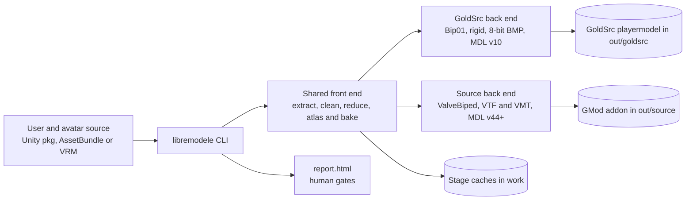

# libremodele

> **Status: planned, nothing built yet.** Superseded in part: A1 (standalone) replaces the Blender, AssetRipper and studiomdl choices in §C, §D and §G. See A7, A9, B1 and C6. This file gets rewritten once those rows are Decided.
>
> Previously: This file describes the proposed design from hobby task #18. Every choice cites a `DECISIONS.md` row, and all of those rows are still Questions. At the end of each phase, update this file to describe what was actually built.

How the system is built. `DECISIONS.md` overrules this file wherever they disagree.



## A. Purpose and scope

Convert a VRChat avatar (the user's own or licensed, A6) into a game-ready **server playermodel** for GoldSrc and Source, with a scripted offline pipeline (A1, A2) that stops at a few defined points for a human to look.

**Goals**
- One command turns an avatar into a playermodel folder that compiles and loads in game.
- Geometry reduction is error-bounded, not "cut to N%" (C2).
- Every decision the pipeline makes automatically is written down and can be overridden (B4, F3).

**Non-goals**
- Real-time or in-game conversion. No VRChat client, mod or upload integration.
- Bringing PhysBones, toon shading, blendshapes or toggles into GoldSrc (B6, B7, C7).
- Custom animations (D7).
- Getting avatars from anywhere other than files the user is licensed to use (A6).

## B. Context

| Actor / external system | Direction | Interface |
|---|---|---|
| User | both | CLI, `avatar.toml`, editable `clean_manifest.json`, `report.html` |
| AssetRipper | out | headless/CLI export (B1) |
| Blender (headless) | out | `blender -b -P stage.py -- args` (A7) |
| MeshLab / meshoptimizer | out | pymeshlab or gltfpack/meshopt (C1) |
| studiomdl (GoldSrc, Source) | out | QC + SMD in, MDL + log out, likely via Wine (A9) |
| Game server / FastDL | out | output folder copied by the user. Nothing is pushed automatically. |

## C. Components

```
             ┌──────────── shared front end ────────────┐
 source ──▶ [1 Extract] ─▶ [2 Clean] ─▶ [3 Reduce] ─▶ [4 Atlas+Bake]
                              │ G1          │ G2           │ G3
                              ▼             ▼              ▼
                        clean_manifest   error report   atlas preview
                                                           │
                         ┌─────────────────────────────────┴───────┐
                         ▼                                         ▼
                [5g Rig→Bip01, rigid]                   [5s Rig→ValveBiped]
                [6g BMP quantise, QC]                   [6s VTF/VMT, QC]
                [7g studiomdl GoldSrc] ── G4/G5         [7s studiomdl Source] ── G4/G5
```

| Component | Responsibility | Depends on | Owns (data/state) |
|---|---|---|---|
| CLI / runner | Reads config, runs stages in order, caches by hash, stops at gates | all | `work/<avatar>/` layout, run log |
| 1 Extract | Source → normalised `.glb` + `avatar.json` (humanoid map, materials, units) | AssetRipper (B1), or none for VRM | `01_extract/` |
| 2 Clean | Remove helpers, shells, toggles and interior; weld; strip degenerates (B3–B5) | Blender | `02_clean/`, `clean_manifest.json` |
| 3 Reduce | Error-capped decimation per target, seams/borders locked (C1–C4) | pymeshlab or meshoptimizer | `03_reduce/<target>/` |
| 4 Atlas + Bake | Re-UV into 1–2 atlases, bake base colour (+normal for Source) (C5–C7) | Blender | `04_bake/<target>/` |
| 5g/5s Rig | Re-pose to target rest pose, map bones, transfer/reduce weights (D1–D4, E1–E2) | Blender | `05_rig/<target>/` |
| 6g/6s Package | Textures to target format, SMD export, QC generation (D5–D8, E3) | Blender Source Tools, libimagequant, VTFLib | `06_pkg/<target>/` |
| 7g/7s Compile | Run studiomdl, parse the log, check limits, lay out the output tree (D9, E4) | studiomdl (A9) | `out/` |
| Report | Renders + metrics + manifest into one HTML page per run (F1) | Blender (renders) | `report.html` |

## D. Key flows

**Stages, tools and inputs/outputs**

| # | Stage | Tool | Input | Output | Automatable? | Manual fallback |
|---|---|---|---|---|---|---|
| 1 | Extract | AssetRipper CLI. VRM: direct import | `.unitypackage` / bundle / `.vrm` | `avatar.glb`, `avatar.json` | Yes | Export the FBX from Unity yourself and point stage 1 at it |
| 2 | Clean | Blender | `avatar.glb` | `clean.glb`, `clean_manifest.json` | Mostly (rules + ray-cast) | Edit the manifest. For odd meshes, delete by hand in Blender and save as `clean.glb` |
| 3 | Reduce | pymeshlab QEC or meshoptimizer | `clean.glb`, budget, error cap | `reduced_<t>.glb`, error stats | Yes | Lower the budget or raise the cap per region; hand-decimate the face if needed |
| 4 | Atlas + bake | Blender (UV pack / xatlas, Cycles bake) | `reduced_<t>.glb` + source textures | `baked_<t>.glb`, `atlas_*.png` | Yes | Move UV islands by hand, or repaint the atlas |
| 5 | Rig | Blender | `baked_<t>.glb`, bone map | `rigged_<t>.blend` | Mostly | Fix the bone map table; adjust the rest pose or rigid assignment by hand |
| 6 | Package | Blender Source Tools, libimagequant, VTFLib | rigged file | `ref.smd`, textures, `.qc` | Yes | Edit the generated QC |
| 7 | Compile + verify | studiomdl (Wine?) | QC + SMD + textures | `.mdl` (+ `T.mdl`), compile log | Yes (compile); check in game is manual | Compile on Windows (Crowbar for Source) |

**Human gates (decision points)**

The runner stops after each gate stage, writes `report.html`, and continues only on `--approve <gate>` (or `--yes` once an avatar has been approved before and nothing changed).

| Gate | After stage | What the human checks | If wrong |
|---|---|---|---|
| G1 | 2 Clean | Nothing needed was deleted (eyes, inner mouth, fingers), and nothing that should go is left (highlight shells, hidden outfits) | Edit `clean_manifest.json`, re-run from 2 |
| G2 | 3 Reduce | Silhouette and face still read at game distance. Error-cap hits are listed | Change the budget, cap or region weights, re-run from 3 |
| G3 | 4 Bake | Atlas has no bleeding or stretched islands. Palette-quantised preview (GoldSrc) does not band on skin and hair | Raise the texture size, change dithering, re-run from 4 |
| G4 | 5 Rig | Pose test: stock run, crouch and aim poses rendered. No tearing at the joints (rigid skinning, D3), no clipping into the hull | Fix the bone map or rest pose, re-run from 5 |
| G5 | 7 Compile | Loads in the model viewer (HLAM / HLMV) and once in a real server; correct height, hitboxes and colours | Depends on the problem; usually back to G4 |

G1–G4 are judged from the report. G5 is the only one that needs the game.

**Run one avatar**
1. User → CLI: `avatar.toml` (source, licence, targets, overrides).
2. CLI → Extract → Clean → stop at G1.
3. User approves → Reduce (per target) → G2 → Atlas/Bake → G3.
4. CLI → GoldSrc and/or Source back end → Rig → G4 → Package → Compile → G5.
5. Output folder ready for the user to copy to the server/FastDL tree.

## E. Data

| Entity | Fields that matter | Stored in | Lifetime |
|---|---|---|---|
| Avatar config | source path, **licence** (A6), target height, budgets, overrides | `avatars/<name>/avatar.toml` | Permanent, versioned |
| Normalised avatar | mesh, skin weights, humanoid map, material → texture links | `work/<name>/01_extract/` | Cache; rebuildable |
| Clean manifest | per object/face-set: keep/delete, rule that fired, override flag | `avatars/<name>/clean_manifest.json` | Permanent once edited |
| Stage outputs | `.glb`/`.blend`/`.png`, keyed by input hash + config | `work/<name>/NN_stage/` | Cache; deletable |
| Run report | renders, counts vs budget, errors, gate approvals | `work/<name>/report.html` | Per run |

Avatar sources and outputs stay out of git (licensed third-party assets).

## F. Interfaces and contracts

| Interface | Kind | Spec location |
|---|---|---|
| CLI (`libremodele run <avatar> [--from stage] [--target goldsrc,source] [--approve Gn]`) | CLI | `docs/cli.md` (to write in Phase B) |
| `avatar.toml` | file | `docs/config.md` (F3) |
| `avatar.json` sidecar | file | `docs/sidecar.md` (B2) |
| `clean_manifest.json` | file | `docs/manifest.md` (B4) |
| Bone map tables (humanoid → Bip01, → ValveBiped) | file | `maps/*.toml` (D2, E1) |
| GoldSrc / Source QC templates | file | `templates/*.qc` (D5–D8, E1–E4) |

## G. Stack

| Need | Choice | Decision |
|---|---|---|
| Runner / CLI | Python | A7 |
| Mesh ops, rig, bake, SMD | Blender headless + Blender Source Tools | A7 |
| Extraction | AssetRipper | B1 |
| Decimation | pymeshlab QEC or meshoptimizer | C1 |
| Palette quantisation | libimagequant / pngquant | D6 |
| Source textures | VTFLib / vtfcmd | E3 |
| Compilers | studiomdl GoldSrc + Source, via Wine or native | A9, A10 |

## H. Quality targets

| Attribute | Target | How checked |
|---|---|---|
| Limits | Output never exceeds the A11 limits (bones, verts/submodel, tris, texture size) | Pre-compile check in stage 6 + studiomdl log parse |
| Geometric fidelity | Max deviation ≤ cap (C2) outside locked regions | Hausdorff/meshopt error in report |
| Determinism | Same input + config → byte-identical SMD/QC | Hash compare in tests |
| Local footprint | One avatar run < 4 GB RAM, < 5 min on the laptop. Above that, run it remotely | Runner timing in report (A8) |
| Compile | 100% of approved avatars compile without studiomdl errors | Stage 7 exit code |

## I. Constraints

**GoldSrc (these drive the design).** These are working numbers until A11 confirms them for the target (A4).

| Constraint | Working value (vanilla HL1) | Design consequence |
|---|---|---|
| Bones | `MAXSTUDIOBONES` 128 | Generous, but PhysBone chains still go: no physics, and they cost nothing visible (D2) |
| Bone weights | **1 bone per vertex** (rigid) | Dominant-bone assignment + joint-crease handling (D3). Lock weight boundaries in decimation (C3) |
| Verts per submodel | ~2048 | Low budget. Decimate hard (C4); split into submodels only as a fallback (D5) |
| Tris | 20000 model max; practical player ≈ 1–5k | Error-capped decimation with per-target budget (C2, C4) |
| Textures | 8-bit indexed, 256 colours per texture, ≈ ≤512², dims multiple of 8 | Atlas into 1–2 textures, bake lighting-neutral albedo, quantise with dithering (C5, C6, D6) |
| Materials | No PBR, no normal maps, no alpha blend. Flags: masked, additive, chrome, fullbright (build-dependent) | Bake base colour only; hair cards → masked; emission → fullbright if supported (C6, C7) |
| Morphs | None | Bake one face (B7) |
| Single vs multi mesh | Each texture is its own mesh. Bodyparts/submodels allowed | 1 bodypart × 1 submodel × 1–2 meshes by default; bodygroups reserved for outfits later (B6, D5) |
| Animations | Player sequences must live in the model, on the Bip01 skeleton | Bind to Bip01 and reuse the stock sequences (D1, D7) |
| Distribution | Clients download `models/player/<n>/<n>.mdl` (+`T.mdl`, `.bmp`) | Small file size matters, and so does the licence (A6, D9) |

**Source (looser, so it gets its own budget, not the GoldSrc output):** 3–4 weights per vertex, ≈128 bones, DXT textures with normal maps, flexes possible, ValveBiped skeleton required for GMod animations (E1–E3).

**Project-wide:** Linux laptop, ~15 GB RAM, no GPU. Heavy jobs go remote (A8). Only licensed sources are used (A6).

## J. Repository layout

```
libremodele/
  libremodele/      Python package: runner, CLI, stage wrappers
  blender/          scripts run inside headless Blender (one per stage)
  maps/             bone map tables (humanoid → Bip01 / ValveBiped)
  templates/        QC templates per target
  docs/             interface specs (cli, config, sidecar, manifest)
  tests/            fixtures (a small CC0 test avatar) + stage tests
  avatars/          per-avatar config + manifests (git-ignored sources)
  work/             stage caches (git-ignored)
  out/              compiled playermodels (git-ignored)
```
