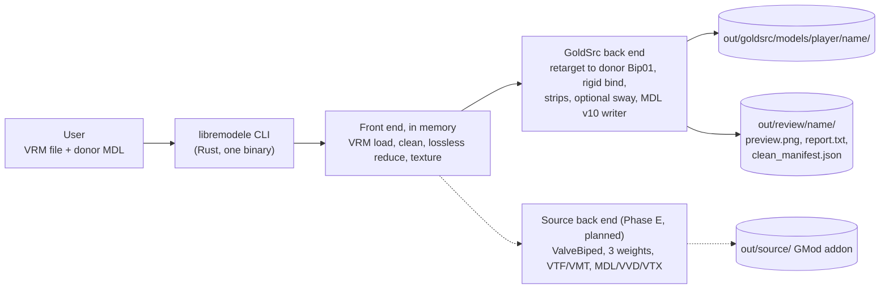

# libremodele

> **Status:** Phase D (GoldSrc back end) is built and matches this file. The Source back end (§C "planned", Phase E) is designed in E1–E4 but not built yet.

How the system is built. `DECISIONS.md` overrules this file wherever they disagree.



## A. Purpose and scope

Convert a VRChat avatar (the user's own or licensed, A6) into a game-ready **server playermodel**, first for GoldSrc (Sven Co-op, A4) and then for Source (GMod first, A2, A3). It is one standalone program (A1): no Blender, Wine, studiomdl, AssetRipper or other external tools. It reads the avatar and writes the game files itself.

**Goals**
- One command turns a VRM into a playermodel folder that loads in game.
- Geometry is never degraded: reduction is lossless (C1, C2).
- Every automatic choice is written down and can be overridden (B4) or is a setting (B8, D16).

**Non-goals**
- Real-time or in-game conversion. No VRChat client, mod or upload integration.
- Unity packages or AssetBundles (A5, B1: VRM only).
- Blendshapes, toggles or toon shading in GoldSrc (B6, B7, C7).
- Custom animations: the donor's sequences are reused (D7).

## B. Context

| Actor / external system | Direction | Interface |
|---|---|---|
| User | both | CLI flags, editable `clean_manifest.json` (B4), `out/review/<name>/` (preview sheet, report) |
| VRM file (glTF binary, VRM 0.x) | in | Read directly (A5, B1) |
| Donor GoldSrc MDL | in | Read directly (A9): skeleton, sequences, hitboxes, controllers, attachments (D1, D7, D8, D14) |
| Game server / FastDL | out | Output folder copied by the user; nothing is pushed. A local fixture with a prohibitive licence must never go there (A6, A13 warns) |

## C. Components

```
 VRM ──▶ [vrm::load] ──▶ [clean] ──▶ [retarget skeleton] ──▶ [bind + reduce] ──▶ [weld, split, strip]
                           │ B3/B4         D1 D2 D4              D3 C1–C3             C2 D5 D11 D12
 donor MDL ──▶ [mdl::read] ┘                                                            │
                                                                                         ▼
       [texture: downscale, quantise] C5–C7 D6 D10 ──▶ [assemble Model: hitboxes D14, controllers,
                                                         attachments, sequences D7] ──▶ [sway, optional D15 D16]
                                                                                         │
                                         [mdl::write] ──▶ [mdl::read, compare] ──▶ [preview sheet + thumbnail] (A14, G5)
```

| Component | File | Responsibility | Decisions |
|---|---|---|---|
| CLI | `src/main.rs` | `convert`, `preview`, `mdl-info`, `mdl-roundtrip`; writes the output and review trees; re-reads the written MDL and fails if it differs | A7, A14, D9, D16 |
| VRM reader | `src/vrm.rs` | glb + VRM 0.x JSON: node tree, humanoid map, licence, skinned bind-pose parts with dominant bone per vertex, first-person annotations, spring groups and colliders | A5, B1, D3, D15 |
| Converter | `src/convert.rs` | Licence warning; clean manifest (rules + overrides); retarget onto the donor's Bip01 with the avatar's proportions; chain bones; rigid binding; weld; split at limits; hitboxes; sequences; sway rig | A11, A13, B3–B8, C4, D1–D14 |
| Reducer | `src/reduce.rs` | Zero-error half-edge collapse, locked on borders, bone boundaries, seams and creases; reports why each vertex was kept | C1–C3 |
| Strips | `src/strip.rs` | Greedy GL triangle strips over exact (vertex, normal, s, t) corners | D11 |
| Textures | `src/texture.rs` | Lanczos downscale (sides a multiple of 8), median-cut to 256 distinct colours, 8-bit BMP | C6, D6, D8 |
| Sway | `src/sway.rs` | UniVRM spring port simulated offline per sequence; channels added root-first within each sequence's 64 KB budget | D13, D15, D16 |
| MDL | `src/mdl/` | GoldSrc MDL v10 in memory: reader, writer (studiomdl section order, textures last), RLE animation codec | A9 |
| Preview | `src/preview.rs` | Software rasteriser: bone poses, contact sheet (rest views + key sequences), winding check | A14 |
| Math | `src/math.rs` | Vectors, 3×3 rotations, rigid transforms, GoldSrc Euler angles | — |
| Source back end | (planned) | ValveBiped mapping, 3 smooth weights, DXT VTF/VMT, MDL/VVD/VTX writer, GMod addon with `$includemodel` animations | E1–E4 |

## D. Key flows

**Convert one avatar** (`libremodele convert <avatar.vrm> --donor <donor.mdl> --name <name> [--height <units>] [--manifest <json>] [--out <dir>] [--sway]`), all in memory, about 0.2 s for Lucian (0.5 s with `--sway`):

1. Load the VRM and the donor. Warn if the licence doesn't clearly allow redistribution (A13).
2. Clean (B3–B7): rules pick the default outfit, neutral face and first-person-only parts; `--manifest` overrides per part (B4). The decisions are written to `clean_manifest.json`.
3. Skeleton (D1, D2, D4): keep the donor's Bip01 bones (fingers merged), give each its avatar frame `Lfr = (Q·R_donor, joint)` so the donor's rotation channels play unchanged, scale root and pelvis by hip height, then add the avatar's spring chains that carry vertices as extra bones under their mapped parent. The avatar is turned to the donor's rest facing; height defaults to the donor's (B8).
4. Bind (D3): each vertex goes to its dominant bone, stored in that bone's `Lfr` frame.
5. Reduce (C1–C3): lossless collapse; nothing changes shape.
6. Weld and split (C2, D5, D12): weld exact corners (coarse normals for flatshade), split into extra bodyparts at 2048 verts/normals or 4080 tris per mesh; strips (D11).
7. Texture (C5–C7, D6, D10): one base image times the colour tint, downscaled to ≤ 512², 8-bit; flatshade for unlit (MToon) avatars.
8. Assemble: donor hitbox set on kept bones (D14), controllers and attachments remapped, sequences copied with chain bones static (D7, D8).
9. Optional sway (D15, D16): simulate the VRM's spring settings per sequence; strands sharing triangles with another strand stay static so the rigid mesh doesn't tear.
10. Write, re-read, compare (A14); render the preview sheet and the 164×200 portrait.

**Human gate.** One gate remains under A14: G5, the user's review of `out/review/<name>/preview.png` and the report. Clean decisions are corrected by editing the manifest and re-running (B4).

## E. Data

| Entity | Fields that matter | Stored in | Lifetime |
|---|---|---|---|
| Avatar source | VRM, **licence** (A6) | `samples/` (git-ignored) or anywhere | User's |
| Clean manifest | per part: keep, rule that fired, override | `out/review/<name>/clean_manifest.json`, fed back with `--manifest` | Per run; the user keeps edited copies |
| Report | licence, bones, cleaning, reduction stats, limits, sway, file size | `out/review/<name>/report.txt` | Per run |
| Playermodel | `<name>.mdl`, `<name>.bmp` portrait | `out/goldsrc/models/player/<name>/` | Output, never committed |

Nothing is cached between runs (B2 superseded: stages run in memory). Avatar sources and outputs stay out of git (A6).

## F. Interfaces and contracts

| Interface | Kind | Spec location |
|---|---|---|
| CLI | CLI | `USAGE` in `src/main.rs`; commands in `AGENTS.md` |
| `clean_manifest.json` | file | Array of `{part, keep, rule, ...}`; only `part` and `keep` are read back (B4) |
| Library API | Rust | `vrm::load`, `mdl::{read, write}`, `convert::convert(&Avatar, &Model, &Options) -> Converted {model, manifest, report, rig}`, `sway::apply`, `preview::sheet` |
| Bone map | code | `HUMANOID` and `CHAINS` tables in `src/convert.rs` (D1, D2) |

## G. Stack

| Need | Choice | Decision |
|---|---|---|
| Language / app | Rust 2024, CLI first, Tauri GUI later | A7 |
| Dependencies | `anyhow`, `serde_json`, `image` (PNG only) | A7 |
| VRM / glTF reading | Own reader | A1, B1 |
| Decimation | Own zero-error collapse | C1 |
| Palette quantisation | Own median cut | D6 |
| MDL writing | Own writer, no studiomdl | A9 |
| Verification | Own re-read + software preview | A14 |
| Source textures (planned) | Own DXT1/DXT5 encoder | E3 |

## H. Quality targets

| Attribute | Target | How checked |
|---|---|---|
| Limits | Never exceeds A11: 128 bones, 2048 verts/normals and 4080 tris per mesh, 20k tris, textures ≤ 512² (D6); warns above Sven's ~9k tris | `convert` bails or warns; `tests/convert.rs` |
| Fidelity | Lossless: no shape change from reduction (C2) | Unit tests in `src/reduce.rs`; tri count in `tests/convert.rs` |
| Correctness | Written MDL reads back identical; yuki_ref round-trips byte-for-byte | `convert` CLI check; `tests/roundtrip.rs` |
| Visual | No torn joints or panels; right facing and winding | Preview sheet (G5); winding test; frame strips via `examples/frames.rs` |
| Animation size | Each sequence's animation data ≤ 64 KB (u16 offsets) | Writer bails; sway budgets root-first |
| Local footprint | Light enough for the laptop (seconds, little RAM) | A8 |

## I. Constraints

**GoldSrc / Sven Co-op (A4, A11).**

| Constraint | Value used | Design consequence |
|---|---|---|
| Bones | 128 | Donor Bip01 (fingers merged) + spring chains (D1, D2) |
| Bone weights | 1 bone per vertex | Dominant bone (D3); bone boundaries locked in reduction (C3); joined sway strands stay static (D15) |
| Verts / normals per mesh | 2048 | Split into extra bodyparts (D5) |
| Tris | 4080 per mesh, 20000 total, ~9k Sven guidance | No budget (C4); warn above 9k (A13); near-lossless option later (C8) |
| Textures | 8-bit, 256 colours, sides multiple of 8; Sven allows 1024², we use 512² | Downscale only (C6, D6) |
| Materials | No normal maps or PBR | Base colour × tint (C7); flatshade for unlit (D10) |
| Animations | Live in the model; RLE shorts; 64 KB per sequence | Donor sequences reused (D7); sway within budget (D15) |
| Player set | Sequence and hitbox sets fixed; no skins or swappable bodies | Donor sets copied (D7, D14) |
| Portrait | 164×200 8-bit BMP with a full 256-colour palette | Palette padded with distinct fillers (D8) |
| Distribution | Clients download `models/player/<n>/<n>.mdl` + `.bmp` | Size matters; sway is opt-in (D16); licence (A6) |

**Source (Phase E):** 3 weights per vertex (VVD), ValveBiped skeleton, animations borrowed from GMod's `m_anm`/`f_anm` via the include-model list, DXT textures, GMod addon layout (E1–E4).

**Project-wide:** Linux laptop, ~15 GB RAM, no GPU. Heavy jobs go remote (A8). Only licensed sources are used (A6).

## J. Repository layout

```
libremodele/
  src/
    main.rs        CLI
    lib.rs         module list
    vrm.rs         VRM reader
    convert.rs     VRM → GoldSrc model
    reduce.rs      lossless edge collapse
    strip.rs       triangle strips
    texture.rs     downscale, quantise, BMP
    sway.rs        spring-bone sway
    preview.rs     software preview
    math.rs        vectors and transforms
    mdl/           MDL v10 model, reader, writer, animation codec
  tests/           roundtrip.rs (yuki_ref), convert.rs (Lucian); skip without samples
  examples/        dev aids: bones, sway_budget, sway_debug, frames
  samples/         licensed fixtures (git-ignored, A6)
  out/             outputs and review files (git-ignored)
```
