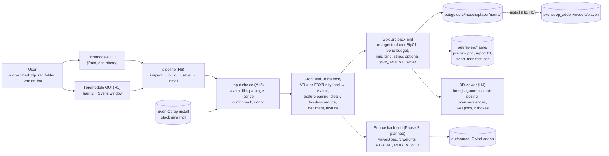

# libremodele

> **Status:** Phases D (GoldSrc back end) and G (FBX + Unity package input) are built and match this file, including the C/D revisions made while hardening on Miku and Neru (C4, C5, C8, C9, D2, D17) and the procedural input of A15 (G11–G27): `convert` takes a download as it came and chooses everything itself. Phase H (desktop GUI, H1–H6) is built: a Tauri 2 + Svelte window over the same library pipeline, with a live 3D viewer and one-click install. The Source back end (§C "planned", Phase E) is designed in E1–E4 but not built yet.

How the system is built. `DECISIONS.md` overrules this file wherever they disagree.



## A. Purpose and scope

Convert a VRChat avatar (the user's own or licensed, A6) into a game-ready **server playermodel**, first for GoldSrc (Sven Co-op, A4) and then for Source (GMod first, A2, A3). It is one standalone program (A1): no Blender, Wine, studiomdl, AssetRipper or other external tools. It reads the avatar and writes the game files itself.

**Goals**
- One command turns a download, as it came (zip, rar, folder, `.vrm` or `.fbx`), into a playermodel folder that loads in game, with no flags (A5, B1, B9, A15). Every choice an agent once made by hand is a rule in the app: which file is the avatar, which package and variant, which texture goes where, the licence, whether the input is an outfit, and the donor (G11–G23).
- Geometry is kept as far as the engine allows: lossless reduction first (C1, C2), then lossy decimation only down to the triangle budget, 20k by default (C4, C8).
- Every automatic choice is written down in the report and can be overridden by a flag (B4, A15: `--donor`, `--avatar`, `--package`, `--licence`, `--variant`, `--material`, `--name`) or is a setting (B8, C4, D16).

**Non-goals**
- Real-time or in-game conversion. No VRChat client, mod or upload integration.
- AssetBundles, ASCII FBX, 7z archives (extract first, G21), or outfits without their base avatar (B9, G17: refused with a clear message).
- Blendshapes, toggles or toon shading in GoldSrc (B6, B7, C7).
- Custom animations: the donor's sequences are reused (D7).

## B. Context

| Actor / external system | Direction | Interface |
|---|---|---|
| User | both | The download path; optional override flags; editable `clean_manifest.json` (B4); `out/review/<name>/` (preview sheet, report) |
| Download (zip, rar, folder, or one `.vrm`/`.fbx` and its folder) | in | Read directly (G16, G21): own zip reader, `rars` for RAR; scans capped at 2 GB, files at 200 MB |
| VRM file (glTF binary, VRM 0.x) | in | Read directly (A5, B1) |
| FBX file (binary 7.x) + `.unitypackage` found in the download | in | Read directly (B9): mesh, skin, bind pose from the FBX; `.mat` materials (prefab overrides by hashed fileID G18, `.meta` remap G20), prefab variant, humanoid map and PhysBones from the package (G1–G11). FBX and VRM files inside packages are candidates too (G16) |
| Licence text in the download | in | VRM meta, `LICENSE`/terms/readme text, also inside packages (G15) |
| Donor GoldSrc MDL | in | Read directly (A9): skeleton, sequences, hitboxes, controllers, attachments (D1, D7, D8, D14). Chosen by real-scale height unless `--donor` is given (G22) |
| Sven Co-op install (Steam) | in | Stock `svencoop/models/player/gina/gina.mdl`, the donor for normal proportions; found in the usual Steam roots and `libraryfolders.vdf` (G22) |
| Game server / FastDL | out | Output folder copied by the user; nothing is pushed. A local fixture with a prohibitive licence must never go there (A6, A13 warns) |

## C. Components

```
 download ──▶ [source: open, rank candidates, licence] G15 G16 G21
                 │
 VRM ──▶ [vrm::load] ─────────────────┐
 FBX ──▶ [fbx::load] ◀── [unitypkg]   ├─▶ Avatar ──▶ [outfit check] G17 ──▶ [clean] ──▶ [retarget + bone budget] ──▶ [bind]
         B9 G1–G11 G18 G20            │    ▲ [pair: textures by seams] G14 G19   B3/B4   D1 D2 D4                  D3
 [donor: by height] G22 ──▶ [mdl::read] ┘                                                                         │
                                                                                                ▼
   [lossless reduce, per texture] C1–C3 ──▶ [decimate to budget] C4 C8 C9 G23 ──▶ [back faces] D17 ──▶ [weld, split, strip] C2 D5 D11 D12
                                                                                                │
   [texture per (image, masked): downscale, quantise] C5–C7 D6 D10 ──▶ [assemble Model: hitboxes D14,
                                              controllers, attachments, sequences D7] ──▶ [sway, optional D15 D16]
                                                                                                │
                                         [mdl::write] ──▶ [mdl::read, compare] ──▶ [preview sheet + thumbnail] (A14, G5)
```

| Component | File | Responsibility | Decisions |
|---|---|---|---|
| Pipeline | `src/pipeline.rs` | The conversion as library calls shared by CLI and GUI: `inspect` (open, choose, name, donor), `build` (convert, sway, write, re-read), `save` (game and review trees), `install` (copy into the addon folder) | H6, A14, A15 |
| GUI backend | `gui/src-tauri/src/` | `session.rs`: one avatar at a time, cached inspection, H5 licence gate on install; `view.rs`: viewer data (geometry in bone space, RGBA textures, per-frame bone locals, Sven `p_*.mdl` list); `lib.rs`: Tauri commands, slow steps on a worker thread, `progress` events | H2–H6 |
| GUI front end | `gui/src/` | Svelte 5 + TypeScript: drop or pick a download, choices panel, main controls + Advanced (H3), progress, report, install with licence tick-box (H5); `Viewer.svelte` + `rig.ts`: three.js skinned meshes with one bone per vertex, gait/upper-body split at `Bip01 Spine`, blends, weapon bone-merge, bones and hitboxes | H2–H5 |
| CLI | `src/main.rs` | `convert <download>` with optional overrides, `preview`, `mdl-info`, `mdl-roundtrip`; writes the output and review trees; re-reads the written MDL and fails if it differs | A7, A14, A15, D9, D16 |
| Input choice | `src/source.rs` | Opens a zip (own reader), rar (`rars`), folder or single file's folder into `Files`; ranks avatar candidates (VRM first; stencil/outline, alt and Quest/Android penalties; the package's own FBX; triangle count), including `.vrm`/`.fbx` inside packages; picks the package and licence text; refuses unsupported archives; default model name from the download | A15, G15, G16, G21 |
| Texture pairing | `src/pair.rs` | For an FBX material with no texture: scores candidate images by colour continuity across the part's UV seams, UV precision on opaque texels and file-name similarity, with margins; an authored FBX colour stays flat | G14, G19 |
| Donor choice | `src/donor.rs` | Real-scale height under 1.4 m → the built-in chibi donor (`donors/yuki_muumuyu.mdl`, embedded, A6/D7 amended), else Sven's stock `gina` from the Steam install; clear error if the needed one is missing; the Sven install and its addon player folder for the GUI | G22, H5 |
| VRM reader | `src/vrm.rs` | glb + VRM 0.x JSON: node tree, humanoid map, licence, skinned bind-pose parts with dominant bone and skin weights per vertex, alpha mode (masked), first-person annotations, spring groups and colliders. Defines `Avatar`, the common input both readers produce | A5, B1, C5, D3, D15 |
| FBX reader | `src/fbx.rs` | Own binary FBX 7.x parser (zlib arrays); Model tree with the full FBX local transform; bind pose from cluster `TransformLink` and BindPose, meshes placed by `TransformLink · Transform`; axes and units from GlobalSettings to Y-up metres; ear-clipped n-gons; parts per (mesh, material slot), slots numbered by first use as Unity does; UVs flipped to top-left; flat-colour parts packed into one swatch texture; humanoid from Unity's map, else by bone name, with skeleton nodes preferred over same-named meshes; PhysBones → spring groups | B9, G1–G3, G5, G6, G10, G18 |
| Unity package reader | `src/unitypkg.rs` | `.unitypackage` tar.gz → assets by GUID and path; Unity YAML documents; prefab or scene variant; `.mat` colour, `_MainTex` and cutout per renderer slot; the FBX `.meta` material remap (`externalObjects`); prefab-instance material overrides; Unity humanoid map from the FBX `.meta`; VRCPhysBone and collider settings. Objects inside prefab instances are found by Unity's hashed fileID (`xxh64` of the object path); the package FBX is matched to a loose FBX by bone overlap | G2, G4, G5, G10, G11, G18, G20 |
| Converter | `src/convert.rs` | Outfit check (rays from the head: under half covered → refused); licence warning; clean manifest (rules + overrides); retarget onto the donor's Bip01 with the avatar's proportions; chain bones and the 128-bone budget (deepest links merged first); smooth repose to the donor's rest pose, then rigid binding; lossless reduce per texture; decimation to the budget; back faces for open sheets from spare budget; weld; split at limits; one texture and mesh per (image, masked); hitboxes; sequences; sway rig | A11, A13, B3–B8, C4, C5, D1–D14, D17, G17, G24–G27 |
| Reducer | `src/reduce.rs` | Zero-error half-edge collapse, locked on borders, bone boundaries, seams and creases; reports why each vertex was kept | C1–C3 |
| Decimator | `src/decimate.rs` | Quadric edge collapse to a triangle budget: optimal placement for free vertices, half-edge with wedge mapping on seams; locks relaxed in stages; clearance caps against nearby layers (hair over scalp, skin over eyes); fold, pinch and link checks; non-manifold edges cut into separate sheets first; separate pieces under 64 triangles (irises, earrings) kept whole, up to a quarter of the budget; deterministic | C4, C8, C9, G23 |
| Strips | `src/strip.rs` | Greedy GL triangle strips over exact (vertex, normal, s, t) corners | D11 |
| Textures | `src/texture.rs` | Lanczos downscale (sides a multiple of 8), median-cut to 256 colours (255 + transparent index for masked), 8-bit BMP | C6, D6, D8 |
| Sway | `src/sway.rs` | UniVRM spring port simulated offline per sequence; channels added root-first within each sequence's 64 KB budget | D13, D15, D16 |
| MDL | `src/mdl/` | GoldSrc MDL v10 in memory: reader, writer (studiomdl section order, textures last), RLE animation codec | A9 |
| Preview | `src/preview.rs` | Software rasteriser: bone poses (locals per sequence, blend and frame; shared with the viewer), masked texels, contact sheet (rest views + key sequences), winding check | A14 |
| Math | `src/math.rs` | Vectors, 3×3 rotations, rigid transforms, GoldSrc Euler angles | — |
| Source back end | (planned) | ValveBiped mapping, 3 smooth weights, DXT VTF/VMT, MDL/VVD/VTX writer, GMod addon with `$includemodel` animations | E1–E4 |

## D. Key flows

**Convert one avatar**, all in memory:

```
libremodele convert <download.zip | download.rar | folder | avatar.vrm | avatar.fbx> [--sway]
  overrides only (A15): [--donor <mdl>] [--name <name>] [--avatar <file>] [--package <x.unitypackage>] [--licence <text>]
                        [--variant <prefab>] [--material <fbx material>=<.mat or image>]... [--height <units>]
                        [--max-tris <n>] [--keep-polygons] [--manifest <json>] [--out <dir>]
```

Run times on the laptop (A8, G8): Lucian 0.2 s; Blondy/Blindy 2–3 s; Neru (63k tris) ~17 s; Tsumire (68k) ~30 s; Lilyanne from her `.rar` (39k) ~33 s; Saji (63k) ~47 s; Gothic Doll is refused as an outfit (G17) before any heavy work.

0. Choose the inputs (A15): open the download (G16, G21), rank the candidate avatar files and name the runners-up in the report, pick the package and the licence text (G15). The default model name comes from the download.
1. Load the avatar into an `Avatar`:
   - **VRM:** humanoid map, spring groups, licence and alpha modes come from the VRM itself.
   - **FBX (phase G):** the FBX gives nodes, skinned bind-pose meshes and FBX materials. The package adds, for the chosen prefab or scene (G4, matched by bone overlap, G11): materials in the order `--material` > prefab override (G18) > `.meta` remap (G20) > FBX material (G2); Unity's humanoid map (G10, else bone names, G1); PhysBones as spring groups (G5). A material still without a texture is paired with one by seam continuity (G14, G19), unless its FBX colour was set by hand. Flat colours share one swatch texture (G3).
   - Stop if the input is an outfit without a base avatar (G17).
   - Warn if the licence doesn't clearly allow redistribution (A13).
   - Without `--donor`, pick the donor by real-scale height (G22).
2. Clean (B3–B7): rules pick the default outfit, neutral face and first-person-only parts; `--manifest` overrides per part (B4). The decisions are written to `clean_manifest.json`.
3. Skeleton (D1, D2, D4): keep the donor's Bip01 bones (fingers merged), give each its avatar frame `Lfr = (Q·R_donor, joint)` so the donor's rotation channels play unchanged, and scale root and pelvis by hip height. Limbs align to the donor's directions; the torso (pelvis to head) keeps the avatar's own posture (G25). Then add the avatar's spring chains that carry vertices as extra bones under their mapped parent. Past 128 bones, the deepest chain links merge into their parents first, spread evenly across chains (D2). The avatar is turned to the donor's rest facing; height defaults to the donor's (B8).
4. Repose and bind: each vertex is posed into the donor's rest pose by blending its bones' bind → rest maps with its skin weights (G24), with the fingers first curled into a grip so weapons sit in a fist (G27), then bound to its dominant bone (D3) in that bone's rest frame.
5. Reduce:
   - lossless collapse per texture (C1–C3);
   - then, if over the budget (`--max-tris`, default and cap 20k, C4), decimation (C8), unless `--keep-polygons` keeps every polygon past the cap with a warning (G26). Non-manifold edges are cut first (C9). Small separate pieces stay whole (G23). Locks relax through stages 0–2, and clearance caps loosen from ¼ of the gap to the next layer up to none, stopping as soon as the budget is met.
   - then, with any budget left, back faces for open sheets, nearest an open edge first (D17).
6. Weld and split (C2, D5, D12): weld exact corners (coarse normals for flatshade), one mesh per texture with its own run of normals, split into extra bodyparts at 2048 verts/normals or 4080 tris per mesh; strips (D11).
7. Texture (C5–C7, D6, D10): one GoldSrc texture per (image, masked) pair, downscaled to ≤ 512², 8-bit; masked textures use index 255 as transparent; flatshade for unlit/toon materials.
8. Assemble: donor hitbox set on kept bones (D14), controllers and attachments remapped, sequences copied with chain bones static (D7, D8).
9. Optional sway (D15, D16): simulate the spring settings per sequence; strands sharing triangles with another strand stay static so the rigid mesh doesn't tear.
10. Write, re-read, compare (A14); render the preview sheet and the 164×200 portrait.

**Human gate.** One gate remains under A14: G5, the user's review of `out/review/<name>/preview.png` and the report, then the in-game check. Clean decisions are corrected by editing the manifest and re-running (B4).

## E. Data

| Entity | Fields that matter | Stored in | Lifetime |
|---|---|---|---|
| Avatar source | A download: zip, rar, folder, VRM, or FBX + `.unitypackage`; **licence** (A6, found by G15) | `samples/`, `~/Downloads` or anywhere (never in git) | User's |
| Donors | chibi `donors/yuki_muumuyu.mdl`, built into the binary (by Yuki, animations by TapChan, shipped with permission); stock `gina.mdl` in the Sven install (G22) | Read only | Yuki and TapChan; Sven Co-op's |
| `Avatar` (in memory) | nodes with bind-pose world frames, humanoid map, spring set and groups, parts (positions, normals, UVs, dominant bone, skin weights, image, masked), images, reader notes | `src/vrm.rs` | Per run |
| Clean manifest | per part: keep, rule that fired, override | `out/review/<name>/clean_manifest.json`, fed back with `--manifest` | Per run; the user keeps edited copies |
| Report | input choice and runners-up, licence, donor and why, reader notes (axes, variant, materials and their source, texture pairing, unresolved references), bones and budget, cleaning, reduction and decimation stats, limits, sway, file size | `out/review/<name>/report.txt` | Per run |
| Playermodel | `<name>.mdl`, `<name>.bmp` portrait | `out/goldsrc/models/player/<name>/` | Output, never committed |

Nothing is cached between runs (B2 superseded: stages run in memory). Avatar sources and outputs stay out of git (A6).

## F. Interfaces and contracts

| Interface | Kind | Spec location |
|---|---|---|
| CLI | CLI | `USAGE` in `src/main.rs`; commands in `AGENTS.md` |
| GUI commands | Tauri IPC | `version`, `inspect(form)`, `convert(form)` + `progress` events, `install(keepLocal)`, `model_view(weapon)`, `texture` and `bone_frames` (binary), `weapons`, `load_weapon`; types in `gui/src/api.ts` |
| `clean_manifest.json` | file | Array of `{part, keep, rule, ...}`; only `part` and `keep` are read back (B4) |
| Library API | Rust | `pipeline::{inspect, build, save, install}`, `source::{Files::open, choose, default_name}`, `donor::choose`, `pair::choose`, `vrm::load`, `fbx::load(&[u8], &fbx::Load)`, `unitypkg::{Package::read, settings}`, `mdl::{read, write}`, `convert::convert(&Avatar, &Model, &Options) -> Converted {model, manifest, report, rig}`, `decimate::decimate`, `sway::apply`, `preview::sheet` |
| Bone map | code | `HUMANOID` and `CHAINS` tables in `src/convert.rs` (D1, D2); bone-name aliases in `fbx::map_by_name` (G1) |

## G. Stack

| Need | Choice | Decision |
|---|---|---|
| Language / app | Rust 2024; CLI and a Tauri 2 desktop GUI over one library (Cargo workspace) | A7, H1, H6 |
| GUI | Tauri 2 (`tauri`, `tauri-build`, `tauri-plugin-dialog`, `serde`); Svelte 5, Vite, TypeScript; `three` for the viewer | H1, H4, H6 |
| Dependencies | `anyhow`, `serde_json`, `image` (PNG only), `flate2` (pure-Rust inflate for FBX arrays, zips and `.unitypackage`), `rars` 0.12.4 without default features (RAR) | A7, B9, G21 |
| Archives | Own zip reader (stored, deflate); `rars` for RAR; 7z refused | G16, G21 |
| VRM / glTF reading | Own reader | A1, B1 |
| FBX / Unity package reading | Own binary FBX parser, own tar and Unity YAML subset reader | B9 |
| Reduction | Own zero-error collapse, then own QEM decimator | C1, C8, G23 |
| Unity fileIDs | Own `xxh64` | G18 |
| Palette quantisation | Own median cut | D6 |
| MDL writing | Own writer, no studiomdl | A9 |
| Verification | Own re-read + software preview | A14 |
| Source textures (planned) | Own DXT1/DXT5 encoder | E3 |

## H. Quality targets

| Attribute | Target | How checked |
|---|---|---|
| Limits | Never exceeds A11: 128 bones, 2048 verts/normals and 4080 tris per mesh, textures ≤ 512² (D6); 20k tris by default, which only `--keep-polygons` may exceed, with a warning (G26); warns above Sven's ~9k tris | `convert` bails or warns; `tests/convert.rs` |
| Fidelity | Lossless below the budget (C2); above it, no layer clipping (hair through scalp, skin over eyes), no folds, outlines held (C8), small pieces such as irises kept (G23) | Unit tests in `src/reduce.rs` and `src/decimate.rs`; previews; in-game check |
| Correctness | Written MDL reads back identical; the built-in yuki donor round-trips byte-for-byte; same input gives the same model | `convert` CLI check; `tests/roundtrip.rs`; determinism asserts in `tests/convert.rs` |
| Generality (A15) | Rules aren't tuned to one avatar: a hold-out of three unseen downloads (Saji, Tsumire, Lilyanne) converts with no flags | `downloads_choose` in `tests/convert.rs`; re-run on each new download |
| Visual | No torn joints or panels; right facing and winding | Preview sheet (G5); winding test; frame strips via `examples/frames.rs` |
| Animation size | Each sequence's animation data ≤ 64 KB (u16 offsets) | Writer bails; sway budgets root-first |
| Local footprint | Minutes at most, little RAM, CPU only (A8, G8) | Timed runs (§D) |

## I. Constraints

**GoldSrc / Sven Co-op (A4, A11).**

| Constraint | Value used | Design consequence |
|---|---|---|
| Bones | 128 | Donor Bip01 (fingers merged) + spring chains; deepest links merged past the limit (D1, D2) |
| Bone weights | 1 bone per vertex | Dominant bone (D3); bone boundaries locked in reduction (C3); joined sway strands stay static (D15) |
| Verts / normals per mesh | 2048 | Split into extra bodyparts (D5); normals run mesh by mesh |
| Tris | 4080 per mesh, 20000 total, ~9k Sven guidance | Default budget 20k, `--max-tris` for less (C4); warn above 9k (A13) |
| Textures | 8-bit, 256 colours, sides multiple of 8; Sven allows 1024², we use 512² | Downscale only (C6, D6); one texture per (image, masked) (C5); index 255 transparent when masked |
| Materials | No normal maps or PBR | Base colour (C7); flat colours in a swatch (G3); flatshade for unlit/toon (D10) |
| Animations | Live in the model; RLE shorts; 64 KB per sequence | Donor sequences reused (D7), the donor matched to the avatar's proportions (G22); sway within budget (D15) |
| Player set | Sequence and hitbox sets fixed; no skins or swappable bodies | Donor sets copied (D7, D14) |
| Portrait | 164×200 8-bit BMP with a full 256-colour palette | Palette padded with distinct fillers (D8) |
| Distribution | Clients download `models/player/<n>/<n>.mdl` + `.bmp` | Size matters; sway is opt-in (D16); licence (A6) |

**Source (Phase E):** 3 weights per vertex (VVD), ValveBiped skeleton, animations borrowed from GMod's `m_anm`/`f_anm` via the include-model list, DXT textures, GMod addon layout (E1–E4).

**Project-wide:** Linux laptop, ~15 GB RAM, no GPU. Heavy jobs go remote (A8). Only licensed sources are used (A6).

## J. Repository layout

```
libremodele/
  src/
    main.rs        CLI
    pipeline.rs    inspect → build → save → install, shared by CLI and GUI (H6)
    lib.rs         module list
    source.rs      download → Files; avatar, package and licence choice (A15)
    pair.rs        texture pairing by seams (G14, G19)
    donor.rs       donor choice by height (G22)
    vrm.rs         VRM reader; the shared Avatar type
    fbx.rs         binary FBX reader (phase G)
    unitypkg.rs    .unitypackage reader (phase G)
    convert.rs     Avatar → GoldSrc model
    reduce.rs      lossless edge collapse
    decimate.rs    QEM decimation to a budget
    strip.rs       triangle strips
    texture.rs     downscale, quantise, BMP
    sway.rs        spring-bone sway
    preview.rs     software preview
    math.rs        vectors and transforms
    mdl/           MDL v10 model, reader, writer, animation codec
  gui/             desktop GUI (H1, H6)
    src/           Svelte front end: App.svelte, Viewer.svelte, rig.ts, api.ts
    src-tauri/     Tauri crate: lib.rs (commands), session.rs, view.rs
  donors/         yuki_muumuyu.mdl, the built-in chibi donor (A6, D7)
  tests/           roundtrip.rs (built-in donor); convert.rs (Lucian, Miku, Neru, Poka, Gothic refused, download choice,
                   archives, names); skip without samples
  examples/        dev aids: bones, sway_budget, sway_debug, frames, avatar_info, parents, tilt,
                   closeup, area_loss, determinism, face, fbx_info, fbx_dump
  samples/         licensed fixtures (git-ignored, A6)
  out/             outputs and review files (git-ignored)
```
