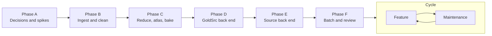

# Roadmap

Planned work, in order. `DECISIONS.md` overrules this file wherever they disagree. Phases are lettered and match decision codes. A phase starts only when its decisions are Decided.

**Task format:** `- [ ] <task> (<codes>). Done when: <check>`

## Phase A: Decisions and spikes

**Goal:** settle what blocks Phase B, and the target numbers that B–D depend on.
**Exit:** every A and B row in `DECISIONS.md` is Decided. A11 limits are recorded.

- [ ] Triage all Question rows with the user (A1–F3). Done when: no row is Question
- [x] Test fixtures: Lucian (VRM/FBX/blend/unitypackage) and yuki_ref (Sven MDL) in `samples/`, local only (A5, A6). Recorded in A5 and A6
- [x] ~~Spike: studiomdl under Wine~~, replaced by A9 (own writer): MDL v10 round trip on yuki_ref (A9, A10). Done when: `cargo test --test roundtrip` passes. Passed 2026-11-14
- [ ] [P] Spike: confirm the GoldSrc + Source limits for the A3/A4 targets (A11). Done when: §I table in `ARCHITECTURE.md` shows confirmed numbers
- [ ] [P] ~~Spike: AssetRipper export~~: pending B1. Under A1, v1 reads VRM directly
- [ ] [P] Spike: interior-face detection, ray-cast vs naming (B5). Done when: B5 has before/after renders of both
- [x] Fill in `AGENTS.md` Commands and scaffold the repo (A7). Done when: the CLI prints usage and `cargo test` passes. Passed 2026-11-14 (A12, the repo licence, still open)

## Phase B: Ingest and clean

**Goal:** any supported source becomes a clean, normalised `clean.glb` + manifest.
**Exit:** fixture avatar passes gate G1 with no manual edits, or with only manifest edits.
**Out of scope:** decimation, rigging.

- [ ] Stage 1 extract → `avatar.glb` + `avatar.json` for VRM and AssetRipper output (B1, B2, A5). Done when: test asserts humanoid map + skin weights present for each fixture
- [ ] Stage 2 rule-based removal: PhysBones, shells, inactive toggles (B3, B4, B6). Done when: manifest lists each removed object with its rule; test on fixture
- [ ] Stage 2 interior removal with area guard (B5). Done when: visible-surface renders before/after differ only in hidden faces (report diff)
- [ ] Stage 2 weld + degenerate strip + blendshape bake + scale (B3, B7, B8). Done when: zero degenerate tris, height = target ±1 unit
- [ ] Manifest override + re-run from stage 2 (B4, F2). Done when: flipping one entry and re-running restores that object
- [ ] Update `ARCHITECTURE.md` (B codes). Done when: sections B to J match the code

## Phase C: Reduce, atlas, bake

**Goal:** per-target reduced meshes with one or two baked atlases.
**Exit:** fixture passes G2 and G3 for the GoldSrc budget.

- [ ] Spike: QEC vs meshoptimizer on the fixture, error + seam integrity (C1). Done when: C1 has a comparison table
- [ ] Stage 3 error-capped decimation with seams, borders and weight boundaries locked (C2, C3, C4). Done when: test asserts error ≤ cap and seam edge count unchanged
- [ ] Stage 4 atlas pack + base-colour bake (C5, C6, C7). Done when: one opaque + optional masked atlas; no UV overlap (test)
- [ ] Report renders for G2/G3 (F1). Done when: `report.html` shows before/after + quantised preview
- [ ] Update `ARCHITECTURE.md` (C codes). Done when: sections B to J match the code

## Phase D: GoldSrc back end

**Goal:** fixture becomes a working HL1 (or A4 target) server playermodel.
**Exit:** model loads in HLAM and on a local listen server, playing the stock animations.

- [ ] Bone map humanoid → Bip01, extra-bone merge (D1, D2). Done when: every mapped bone present; test on fixture
- [ ] Re-pose to Bip01 reference + rigid weight assignment with joint handling (D3, D4). Done when: G4 pose renders show no torn joints
- [ ] 8-bit palette quantise + masked handling (D6). Done when: BMPs pass the A11 size/divisibility check
- [ ] SMD + QC generation with stock sequences, hitboxes, thumbnail (D5, D7, D8). Done when: QC compiles with studiomdl (A10 command)
- [ ] Pre-compile limit check + output tree (D9, A11). Done when: an over-budget fixture fails with a clear message before studiomdl runs
- [ ] Manual G5: load in game. Done when: user confirms in a DECISIONS note
- [ ] Update `ARCHITECTURE.md` (D codes). Done when: sections B to J match the code

## Phase E: Source back end

**Goal:** fixture becomes a GMod (or A3 target) server playermodel addon.
**Exit:** addon loads on a local server and the model is selectable and animates.

- [ ] ValveBiped mapping + smooth-weight cap (E1, E2). Done when: max weights/vertex ≤ A11 value (test)
- [ ] VTF/VMT generation (E3). Done when: textures open in a VTF viewer / load in game
- [ ] QC with `$includemodel` anims + addon layout + Lua registration (E1, E4). Done when: compile passes and the addon folder matches the spec
- [ ] Manual G5 in game. Done when: user confirms
- [ ] Update `ARCHITECTURE.md` (E codes). Done when: sections B to J match the code

## Phase F: Batch and review

**Goal:** convert several avatars in one run, with gates collected into reports.
**Exit:** 3 avatars run end to end, each stopping only at the gates that need a look.

- [ ] Stage caching by hash + `--from` re-runs (F2). Done when: an unchanged re-run skips every stage
- [ ] `avatar.toml` defaults + overrides (F3). Done when: per-avatar budget override reaches stage 3
- [ ] Remote execution hook for heavy runs (A8). Done when: a batch can be sent to Kaggle/GPU server and results pulled back
- [ ] Update `ARCHITECTURE.md` (F codes). Done when: sections B to J match the code

## Cycle: feature and maintenance

Candidate future features (each one a Question row first): outfit toggles as bodygroups (B6), Source flex visemes (B7), Sven Co-op high-limit profile (A4), FastDLX upload integration (E4).

**Maintenance turn** (per release)
- [ ] Tool versions reviewed: Blender, AssetRipper, meshoptimizer, studiomdl (A7, B1, C1, A9). Done when: fixture runs end to end on the new versions
- [ ] Docs match reality. Done when: no Decided row contradicts the code or `ARCHITECTURE.md`
- [ ] Stale rows closed or reopened. Done when: no TBD or Inspect row older than one cycle
