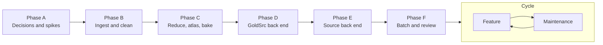

# Roadmap

Planned work, in order. `DECISIONS.md` overrules this file wherever they disagree. Phases are lettered and match decision codes. A phase starts only when its decisions are Decided.

**Task format:** `- [ ] <task> (<codes>). Done when: <check>`

## Phase A: Decisions and spikes

**Goal:** settle what blocks Phase B, and the target numbers that B–D depend on.
**Exit:** every A and B row in `DECISIONS.md` is Decided. A11 limits are recorded.

- [x] Triage all Question rows with the user (A1–F3). Done when: no row is Question. Passed 2026-11-14 (C8 Decided; E1–E4 Decided; F1–F3 TBD until Phase F)
- [x] Test fixtures: Lucian (VRM/FBX/blend/unitypackage) and yuki_ref (Sven MDL) in `samples/`, local only (A5, A6). Recorded in A5 and A6
- [x] ~~Spike: studiomdl under Wine~~, replaced by A9 (own writer): MDL v10 round trip on yuki_ref (A9, A10). Done when: `cargo test --test roundtrip` passes. Passed 2026-11-14
- [ ] [P] Spike: confirm the GoldSrc + Source limits for the A3/A4 targets (A11). Done when: §I table in `ARCHITECTURE.md` shows confirmed numbers
- [ ] [P] ~~Spike: AssetRipper export~~: pending B1. Under A1, v1 reads VRM directly
- [ ] [P] Spike: interior-face detection, ray-cast vs naming (B5). Done when: B5 has before/after renders of both
- [x] Fill in `AGENTS.md` Commands and scaffold the repo (A7). Done when: the CLI prints usage and `cargo test` passes. Passed 2026-11-14 (A12, the repo licence, still open)

## Phase B: Ingest and clean

**Goal:** any supported source becomes a clean, normalised `clean.glb` + manifest.
**Exit:** fixture avatar passes gate G1 with no manual edits, or with only manifest edits.
**Out of scope:** decimation, rigging.

- [x] Stage 1: read VRM directly (B1, A5). B2's intermediate files are replaced by in-memory stages inside one binary (A1). Done when: `tests/convert.rs` loads Lucian. Passed 2026-11-14
- [x] Stage 2 rules: first-person-only meshes and eye-highlight shells (B3, B4). Done when: the manifest lists each part with its rule. Passed 2026-11-14 (Lucian has nothing to drop)
- [x] ~~Stage 2 interior removal~~: not in v1 (B5)
- [x] Weld + degenerate removal + neutral face + scale (B3, B7, B8, C2). Done when: height = target ±1 unit (`tests/convert.rs`). Passed 2026-11-14
- [x] Manifest override via `--manifest` (B4). Done when: flipping one entry changes the output. Passed 2026-11-14 (dropping EAR_RINGS: 6,356 → 6,068 tris)
- [ ] Update `ARCHITECTURE.md` (B codes). Done when: sections B to J match the code

## Phase C: Reduce, atlas, bake

**Goal:** per-target reduced meshes with one or two baked atlases.
**Exit:** fixture passes G2 and G3 for the GoldSrc budget.

- [ ] Spike: QEC vs meshoptimizer on the fixture, error + seam integrity (C1). Done when: C1 has a comparison table
- [ ] Stage 3 error-capped decimation with seams, borders and weight boundaries locked (C2, C3, C4). Done when: test asserts error ≤ cap and seam edge count unchanged
- [x] Single texture: downscale to 512² + 256-colour median cut (C5, C6, D6). Done when: `tests/convert.rs` checks 512×512, flatshade. Passed 2026-11-14. Multi-texture atlasing stays open for the next avatar that needs it
- [ ] Report renders for G2/G3 (F1). Done when: `report.html` shows before/after + quantised preview
- [ ] Update `ARCHITECTURE.md` (C codes). Done when: sections B to J match the code

## Phase D: GoldSrc back end

**Goal:** fixture becomes a working HL1 (or A4 target) server playermodel.
**Exit:** model loads in HLAM and on a local listen server, playing the stock animations. **Met 2026-11-14** in Sven Co-op (A4) on a local listen server, via `svencoop_addon/` (HLAM not used, A14): menu and portrait, idle/run/crouch/jump/aim/death, height and facing, and `--sway` (ears and front hair swing, dress solid) all confirmed by the user, no issues.

- [x] Bone map humanoid → Bip01; fingers/toes/eyes merged; hair/ear/dress chains kept (D1, D2). Done when: test checks chains present, fingers and donor extras absent. Passed 2026-11-14
- [x] Retarget to the donor skeleton with Lucian's proportions + dominant-bone binding (D3, D4). Done when: preview sheet shows no torn joints. Passed 2026-11-14 (`out/review/lucian/preview.png`)
- [x] 8-bit palette quantise (D6). Masked materials are not handled yet: Lucian is opaque. Passed 2026-11-14
- [x] MDL written directly with donor sequences, hitboxes, controllers, attachments, thumbnail (A9, D5, D7, D8). Done when: re-read is identical. Passed 2026-11-14
- [x] Limit checks + output tree (D9, A11): bones, verts and normals per mesh, 4,080 tris per mesh, 20k tris, Sven 9k warning, D14 hitboxes, full portrait palette. Done when: `tests/convert.rs` passes. Passed 2026-11-14
- [x] Zero-error edge collapse with C3 locks (C1, C2, C3). Done when: unit tests show a flat grid reduced to its border with the same area and UVs, bone halves never merged, and folds and seams blocked. Passed 2026-11-14. Lucian: 0 of 3,340 vertices removable (already minimal); the report lists which rule kept each vertex
- [x] Spike: procedural sway for chain bones (D13, D15). Done when: D15 has a design with evidence. Passed 2026-11-14 (Option A chosen)
- [x] Optional chain sway, UniVRM spring port (D13, D15, D16). Done when: `--sway` adds sway within every sequence's 64 KB budget, body channels unchanged, re-read identical (`tests/convert.rs`), and frame strips show no tearing. Passed 2026-11-14: Lucian 10 bones, 192/192 sequences, +0.51 MB
- [x] G5 under A14: user reviewed `out/review/lucian/preview.png` and the thumbnail. Done when: user confirms. Confirmed 2026-11-14; in-game check passed the same day
- [x] Update `ARCHITECTURE.md` (D codes). Done when: sections B to J match the code. Passed 2026-11-14 (full rewrite to the standalone Rust design; Source back end marked planned)

### Hardening before "stable" (user, 2026-11-14): three more avatars

- [x] Miku (VRM, 65,737 tris, 191 bones, 4 images with alpha) converts: bone budget merges the deepest chain links (D2), one texture per (image, masked) with per-mesh normal runs (C5, D6), lossy QEM to the 20k default budget (C4, revised after the first in-game test showed a bald, broken face at 9k) with optimal placement, staged locks and layer clearance caps so skin can't move through the hair or over the eyes (C2, C8), deterministic output. Done when: `tests/convert.rs` `miku_converts` passes. Passed 2026-11-14
- [x] Miku in game (Sven, local listen server, `miku` and `miku_sway`). Done when: user confirms. Confirmed 2026-11-15 after the C4/C8 fixes (first try at 9k failed: bald, broken face)
- [ ] Neru and Gothic Doll: FBX only, blocked on B9 (FBX input, Question)

## Phase E: Source back end

**Goal:** fixture becomes a GMod (or A3 target) server playermodel addon.
**Exit:** addon loads on a local server and the model is selectable and animates.

- [ ] ValveBiped mapping + smooth-weight cap (E1, E2). Done when: max weights/vertex ≤ A11 value (test)
- [ ] Own DXT1/DXT5 VTF + VMT writer (E3). Done when: textures open in a VTF viewer / load in game
- [ ] Own Source MDL/VVD/VTX writer with `$includemodel` anims, addon layout + Lua registration (A1, E1, E4). Done when: our re-read matches and the addon folder matches the spec
- [ ] Manual G5 in game. Done when: user confirms
- [ ] Update `ARCHITECTURE.md` (E codes). Done when: sections B to J match the code

## Phase F: Batch and review

**Goal:** convert several avatars in one run, with gates collected into reports.
**Exit:** 3 avatars run end to end, each stopping only at the gates that need a look.

- [ ] Stage caching by hash + `--from` re-runs (F2). Done when: an unchanged re-run skips every stage
- [ ] `avatar.toml` defaults + overrides (F3). Done when: per-avatar budget override reaches stage 3
- [ ] Remote execution hook for heavy runs (A8). Done when: a batch can be sent to Kaggle/GPU server and results pulled back
- [ ] Update `ARCHITECTURE.md` (F codes). Done when: sections B to J match the code

## Cycle: feature and maintenance

Candidate future features (each one a Question row first): outfit toggles as bodygroups (B6), Source flex visemes (B7), Sven Co-op high-limit profile (A4), FastDLX upload integration (E4).

**Maintenance turn** (per release)
- [ ] Tool versions reviewed: Blender, AssetRipper, meshoptimizer, studiomdl (A7, B1, C1, A9). Done when: fixture runs end to end on the new versions
- [ ] Docs match reality. Done when: no Decided row contradicts the code or `ARCHITECTURE.md`
- [ ] Stale rows closed or reopened. Done when: no TBD or Inspect row older than one cycle
